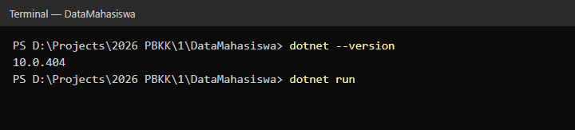
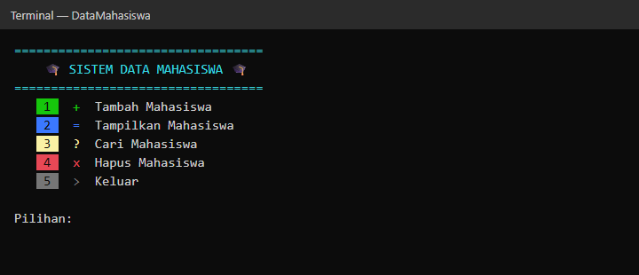
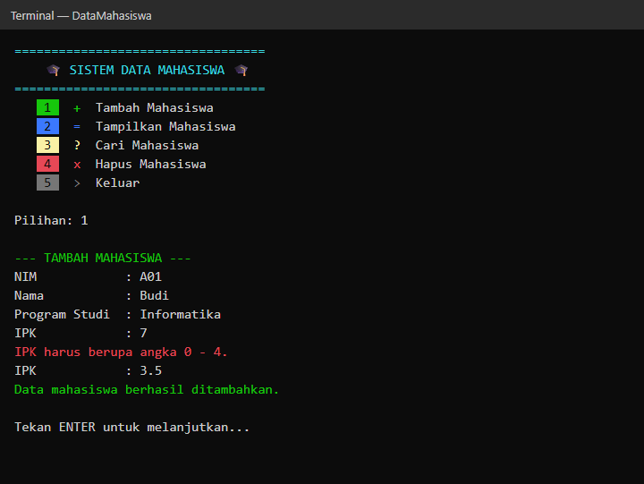
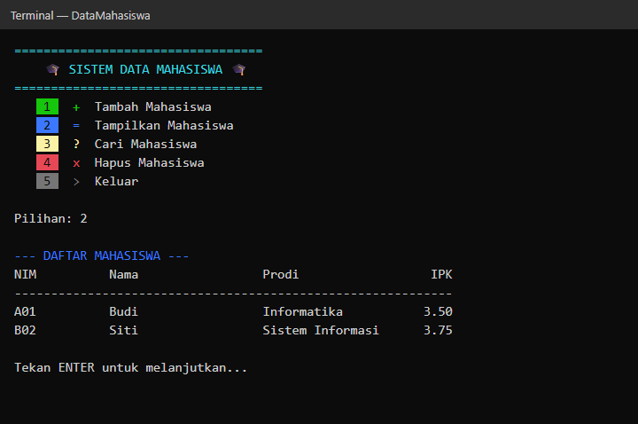
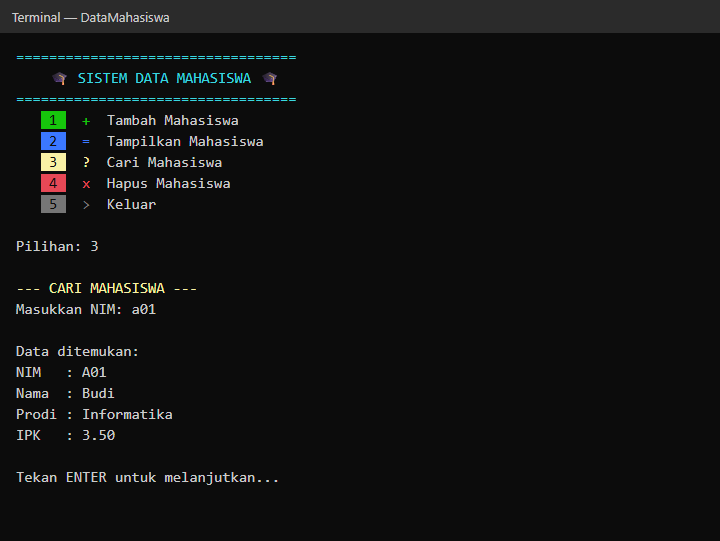
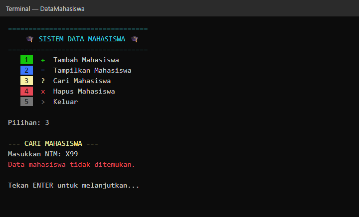
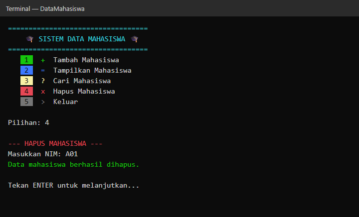
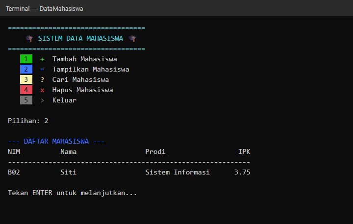
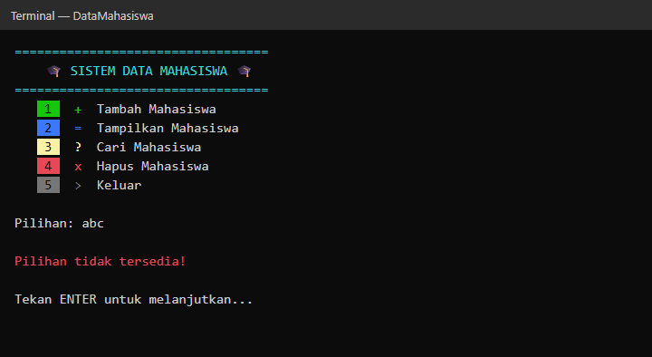
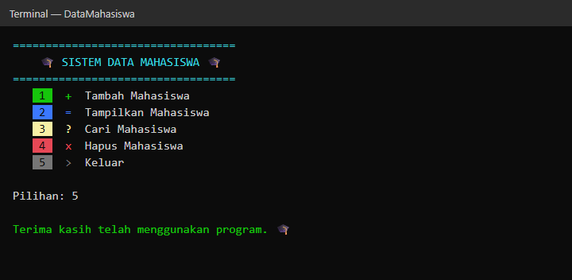

# Tugas 1 PBKK — Instalasi .NET & Sistem Data Mahasiswa (C# Console)

Panduan menyiapkan lingkungan pengembangan .NET dari nol sampai berhasil menjalankan program **Sistem Data Mahasiswa** berbasis console application C#.

> Versi siap-tempel untuk Blogspot ada di [`blogspot.html`](blogspot.html) — buka Blogger → New Post → ganti ke **HTML view** → paste seluruh isinya.

## Struktur Folder

```
1-Instalasi-DotNet-DataMahasiswa/
├── README.md
├── blogspot.html
└── DataMahasiswa/
    ├── DataMahasiswa.csproj
    └── Program.cs
```

## Langkah-langkah

### 1. Instal .NET SDK
Unduh **.NET SDK** (bukan Runtime) versi LTS dari https://dotnet.microsoft.com/download, jalankan installer, lalu cek di terminal baru:

```bash
dotnet --version
```

Jika muncul nomor versi (misal `8.0.426`), instalasi berhasil.

### 2. Instal Visual Studio Code
Unduh dari https://code.visualstudio.com dan instal.

### 3. Pasang Ekstensi C# Dev Kit
Tekan `Ctrl+Shift+X`, cari **C# Dev Kit** (Microsoft), lalu Install. Ekstensi ini memberi IntelliSense, debugging, dan integrasi proyek .NET.

### 4. Buat & Jalankan Hello World
```bash
dotnet new console -n HelloWorld
cd HelloWorld
dotnet run
```
Output: `Hello, World!`

### 5. Buat Proyek DataMahasiswa
```bash
cd ..
dotnet new console -n DataMahasiswa
cd DataMahasiswa
code .
```

### 6. Ganti Isi Program.cs
Hapus isi `Program.cs` bawaan, ganti dengan kode dari [`DataMahasiswa/Program.cs`](DataMahasiswa/Program.cs), lalu simpan (`Ctrl+S`).

### 7. Jalankan & Uji
```bash
dotnet run
```

| Menu | Yang diuji |
|---|---|
| 1 — Tambah | Isi NIM, Nama, Prodi, IPK. Coba IPK `7` → harus ditolak. NIM ganda juga ditolak. |
| 2 — Tampilkan | Data tampil dalam tabel rapi, IPK 2 desimal. |
| 3 — Cari | Cari NIM yang ada & yang tidak ada (tidak membedakan huruf besar/kecil). |
| 4 — Hapus | Hapus data, cek lagi di menu 2. |
| 5 — Keluar | Program menampilkan pesan penutup dan berhenti. |

Contoh output menu 2:

```
--- DAFTAR MAHASISWA ---
NIM          Nama                 Prodi                  IPK
------------------------------------------------------------
A01          Budi                 Informatika           3.50
B02          Siti                 SI                    3.75
```

## Screenshot

| | |
|---|---|
| Cek SDK & jalankan<br> | Menu utama<br> |
| Tambah (IPK 7 ditolak)<br> | Tampilkan<br> |
| Cari (ditemukan)<br> | Cari (tidak ditemukan)<br> |
| Hapus<br> | Setelah dihapus<br> |
| Input bukan angka<br> | Keluar<br> |

## Penjelasan Kode

- **`class Mahasiswa`** — blueprint data dengan 4 auto-property (`NIM`, `Nama`, `Prodi`, `IPK`) dan constructor yang mewajibkan semua nilai diisi. NIM bertipe `string` (bisa diawali 0, tidak dihitung), IPK bertipe `double`.
- **`List<Mahasiswa>`** — penyimpanan dinamis (bisa `.Add()` / `.Remove()`), disimpan di RAM sehingga data hilang saat program ditutup.
- **`Main()`** — loop `do...while` menampilkan menu sampai pengguna memilih 5. `int.TryParse` dipakai agar input bukan angka tidak membuat program crash; `switch` menyalurkan pilihan ke method masing-masing.
- **`TampilkanMenu()` & `TulisMenuItem()`** — tampilan berwarna memakai `Console.ForegroundColor` / `BackgroundColor`. Pola selalu: set warna → tulis → `ResetColor()`. Efek "kotak nomor" dibuat dari latar berwarna + spasi (`" 1 "`).
- **`TambahMahasiswa()`** — validasi IPK dengan `while (true)` + `break`: harus angka (`double.TryParse`) **dan** di rentang 0–4. Input `3,5` maupun `3.5` sama-sama diterima.
- **`TampilkanMahasiswa()`** — guard clause untuk daftar kosong, lalu tabel dengan format `{0,-12}` (rata kiri, lebar 12) dan `{3,5:F2}` (rata kanan, 2 desimal).
- **`CariBerdasarkanNIM()`** — pencarian linear dengan `StringComparison.OrdinalIgnoreCase`, dipakai bersama oleh menu Tambah (cek duplikat), Cari, dan Hapus. Penghapusan dilakukan **setelah** loop selesai agar tidak memicu `InvalidOperationException`.
- **`CultureInfo.InvariantCulture`** — memastikan desimal selalu memakai titik walau Windows berbahasa Indonesia.

## Ringkasan Perintah
```bash
dotnet --version
dotnet new console -n HelloWorld && cd HelloWorld && dotnet run
cd .. && dotnet new console -n DataMahasiswa && cd DataMahasiswa && code .
dotnet run
```
