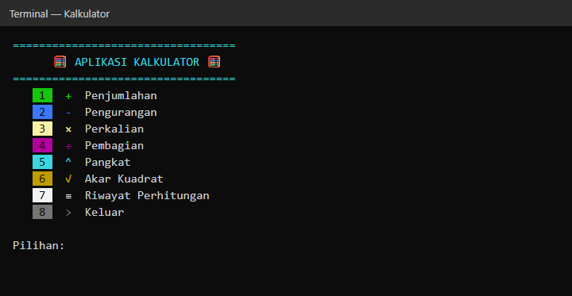
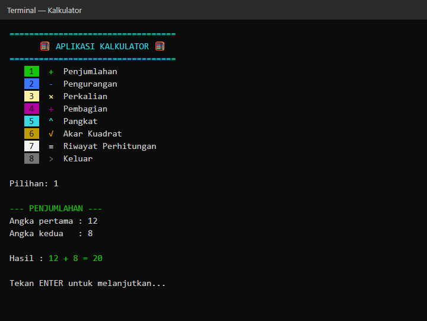
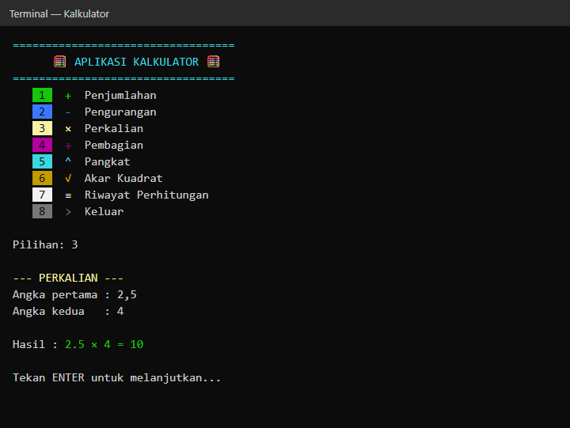
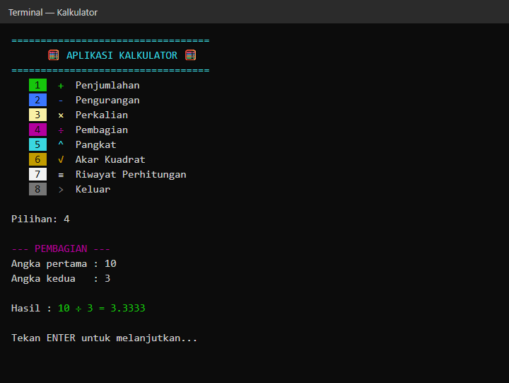
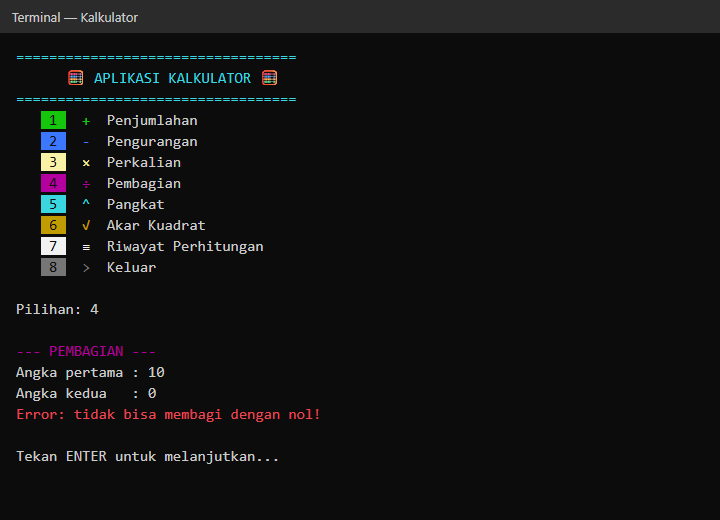
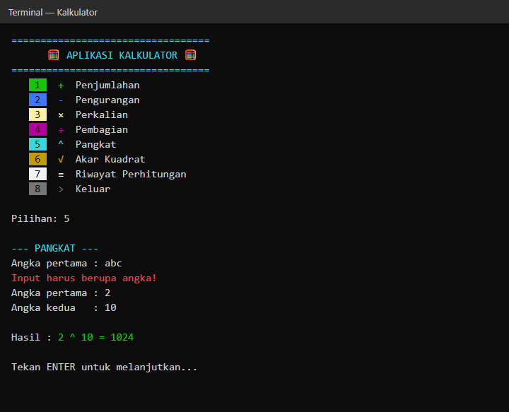
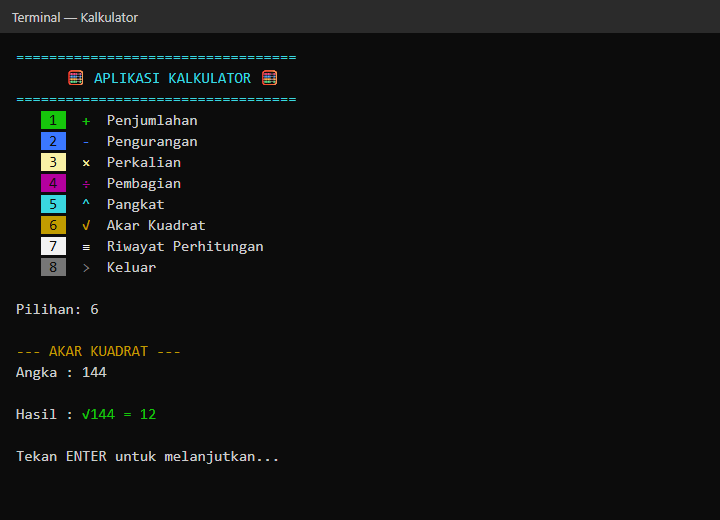
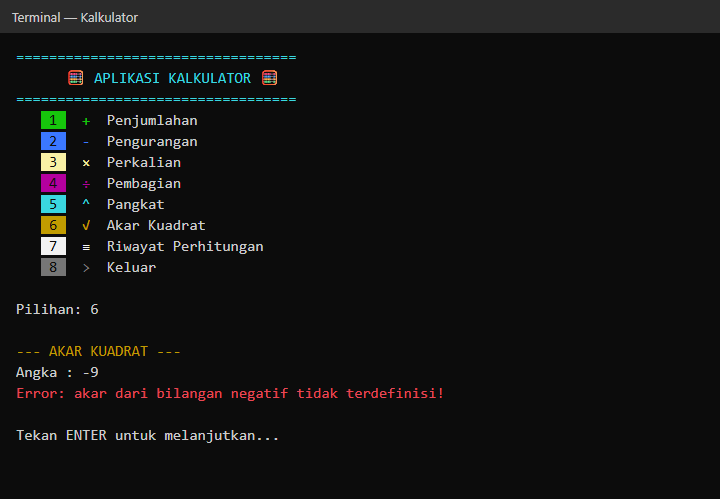
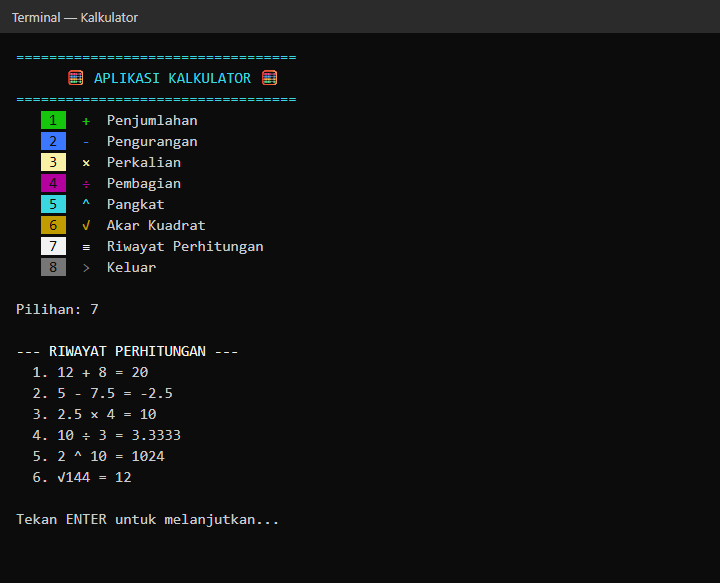
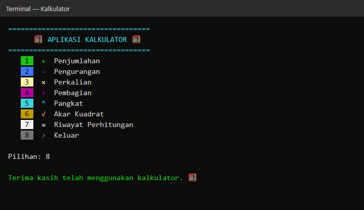

# Tugas 2 PBKK — Aplikasi Kalkulator (C# Console)

Aplikasi kalkulator berbasis console application C# dengan menu berwarna, validasi input, penanganan error (bagi nol & akar negatif), dan riwayat perhitungan.

> Versi siap-tempel untuk Blogspot ada di [`blogspot.html`](blogspot.html) — buka Blogger → New Post → ikon pensil → **HTML view** → paste seluruh isinya.

## Struktur Folder

```
2-Aplikasi-Kalkulator/
├── README.md
├── blogspot.html
├── screenshots/
└── Kalkulator/
    ├── Kalkulator.csproj
    └── Program.cs
```

## Fitur

| Menu | Operasi | Keterangan |
|---|---|---|
| 1 | Penjumlahan | `a + b` |
| 2 | Pengurangan | `a - b` |
| 3 | Perkalian | `a × b` |
| 4 | Pembagian | `a ÷ b`, menolak pembagian dengan nol |
| 5 | Pangkat | `a ^ b` memakai `Math.Pow` |
| 6 | Akar Kuadrat | `√a` memakai `Math.Sqrt`, menolak bilangan negatif |
| 7 | Riwayat | Menampilkan semua perhitungan sebelumnya |
| 8 | Keluar | Menutup program |

## Langkah-langkah

> Langkah instalasi .NET SDK, VS Code, dan C# Dev Kit sama seperti Tugas 1.

### 1. Buat Proyek
```bash
dotnet new console -n Kalkulator
cd Kalkulator
code .
```

### 2. Ganti Isi Program.cs
Hapus isi `Program.cs` bawaan, ganti dengan kode dari [`Kalkulator/Program.cs`](Kalkulator/Program.cs), lalu simpan (`Ctrl+S`).

### 3. Jalankan & Uji
```bash
dotnet run
```

| Uji | Input | Hasil yang diharapkan |
|---|---|---|
| Penjumlahan | `12` dan `8` | `12 + 8 = 20` |
| Desimal (titik/koma) | `2,5` × `4` | `2.5 × 4 = 10` |
| Bagi nol | `10` ÷ `0` | `Error: tidak bisa membagi dengan nol!` |
| Input huruf | `abc` | `Input harus berupa angka!` lalu diminta ulang |
| Akar negatif | `-9` | `Error: akar dari bilangan negatif tidak terdefinisi!` |
| Riwayat | menu 7 | Semua perhitungan berhasil tercantum bernomor |

## Screenshot

| | |
|---|---|
| Menu utama<br> | Penjumlahan<br> |
| Perkalian (input koma)<br> | Pembagian<br> |
| Bagi dengan nol<br> | Pangkat (input huruf ditolak)<br> |
| Akar kuadrat<br> | Akar negatif<br> |
| Riwayat<br> | Keluar<br> |

## Penjelasan Kode

- **`List<string> riwayat`** — setiap hasil perhitungan disimpan sebagai teks (misal `12 + 8 = 20`) agar bisa ditampilkan di menu Riwayat. Disimpan di RAM, jadi hilang saat program ditutup.
- **`Main()`** — loop `do...while` dengan `int.TryParse` (anti-crash) dan `switch` yang menyalurkan pilihan ke method. Lima operasi dua angka cukup memanggil satu method `HitungDuaAngka()` dengan parameter simbol, judul, dan warna yang berbeda.
- **`BacaAngka()`** — loop `while (true)` yang terus meminta input sampai berupa angka. Koma diganti titik (`Replace(',', '.')`) sehingga `2,5` dan `2.5` sama-sama diterima.
- **`HitungDuaAngka()`** — `switch` pada simbol operator. Sebelum membagi, dicek `b == 0`; jika ya, tampil pesan error dan `return` lebih awal (guard clause) sehingga tidak menghasilkan `∞`. Pangkat memakai `Math.Pow(a, b)`.
- **`HitungAkar()`** — menolak bilangan negatif karena `Math.Sqrt(-9)` menghasilkan `NaN`.
- **`TampilkanHasil()`** — mencetak hasil berwarna hijau sekaligus menambahkannya ke riwayat. Hanya perhitungan yang berhasil yang masuk riwayat.
- **`Format()`** — `ToString("0.####")` menampilkan maksimal 4 desimal tanpa nol berlebih: `10 ÷ 3 = 3.3333`, `2.5 × 4 = 10`.
- **`TulisMenuItem()` & `TulisWarna()`** — helper pewarnaan dengan pola set warna → tulis → `ResetColor()`, agar kode tidak berulang.
- **`CultureInfo.InvariantCulture`** — desimal selalu memakai titik walau Windows berbahasa Indonesia.

## Ringkasan Perintah
```bash
dotnet new console -n Kalkulator
cd Kalkulator
code .
dotnet run
```
