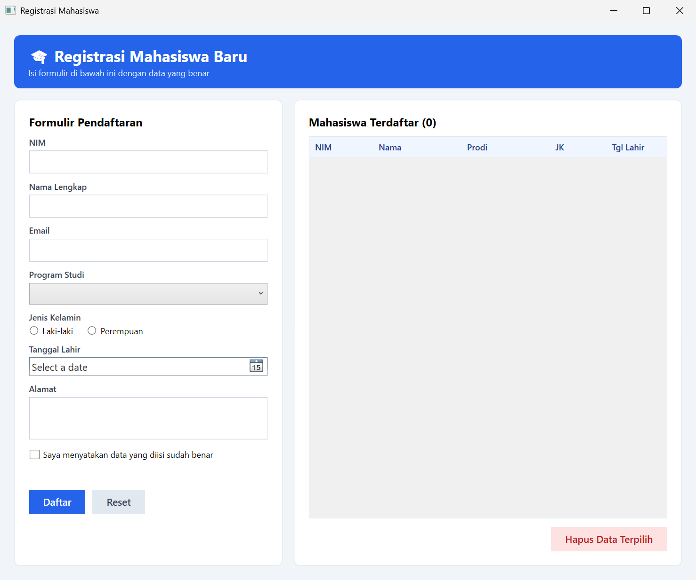
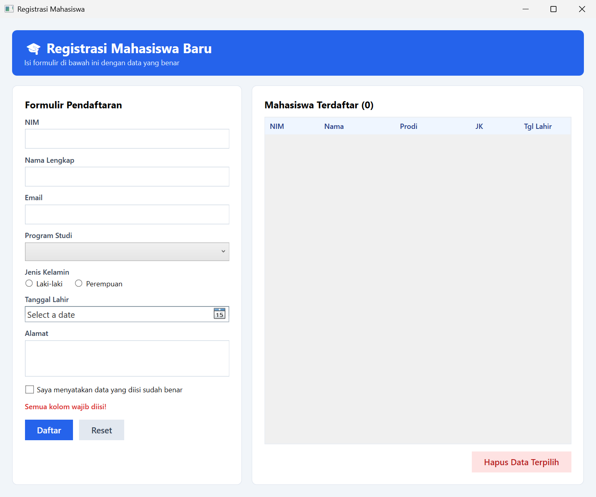
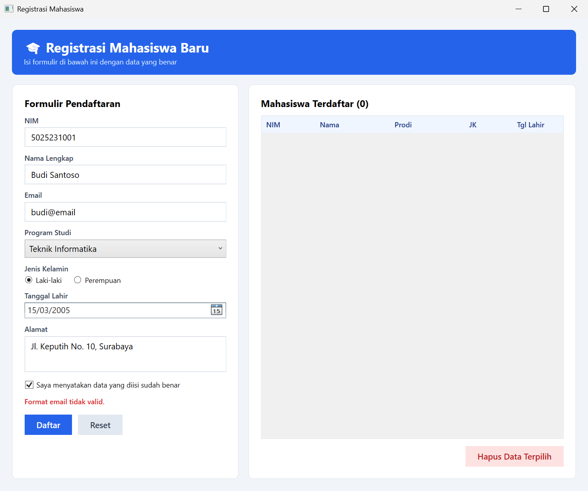
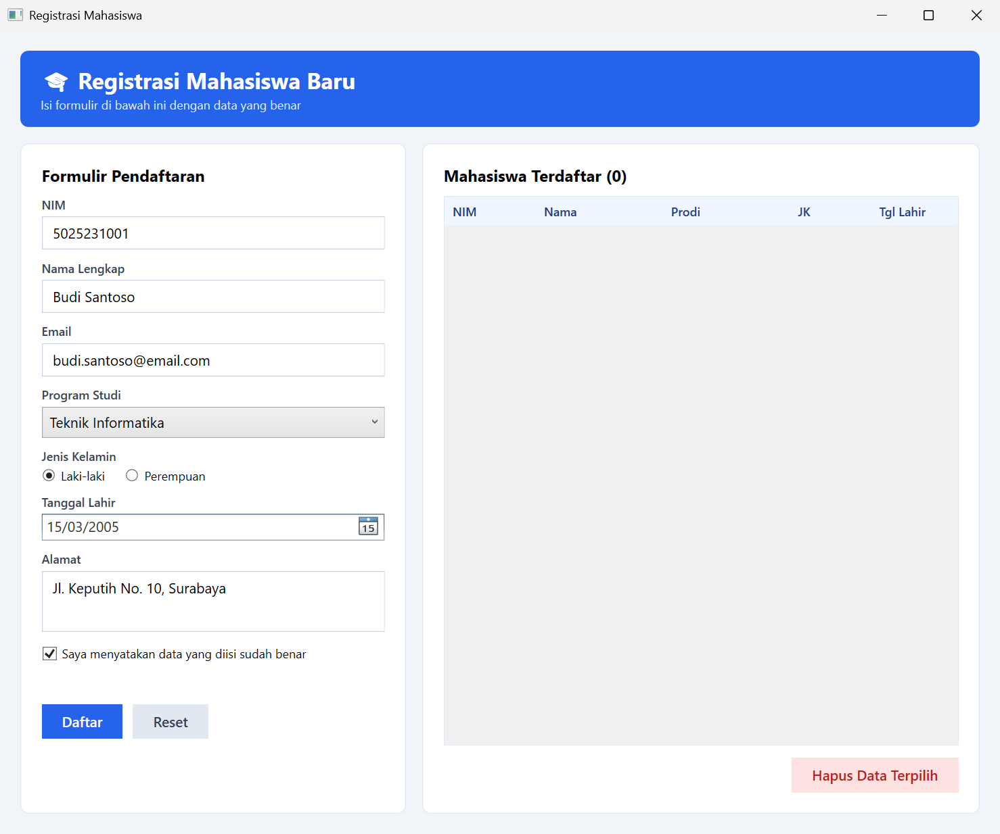
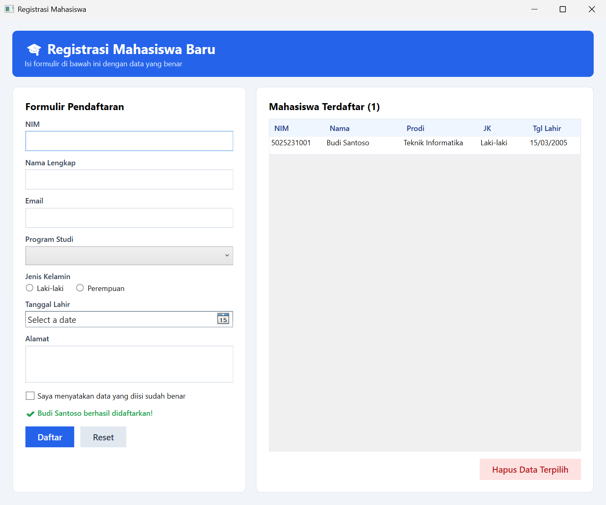
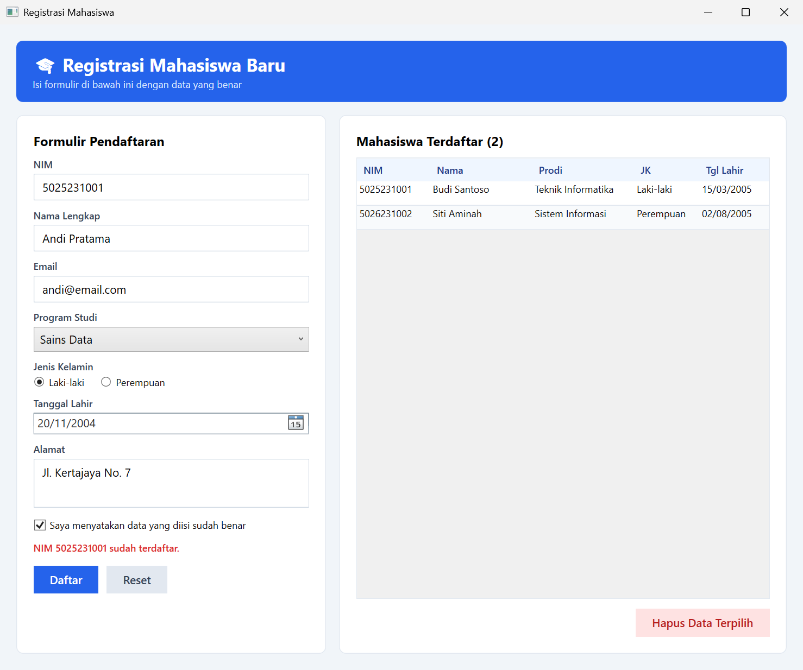
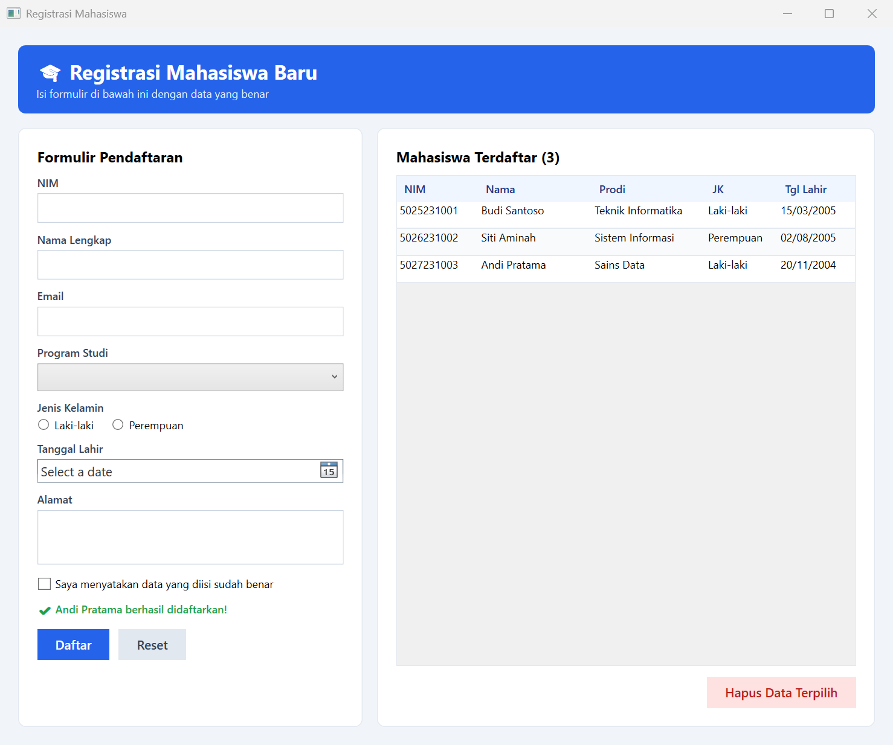

# Tugas 3 PBKK — UI Registrasi Mahasiswa (WPF .NET)

Aplikasi desktop sederhana untuk registrasi mahasiswa menggunakan **WPF (Windows Presentation Foundation)** di .NET 8. Tampilan dibuat dengan **XAML**, logika ditulis di **C# code-behind**.

> Versi siap-tempel untuk Blogspot ada di [`blogspot.html`](blogspot.html) — buka Blogger → New Post → ikon pensil → **HTML view** → paste seluruh isinya.

## Struktur Folder

```
3-Registrasi-Mahasiswa-WPF/
├── README.md
├── blogspot.html
├── screenshots/
└── RegistrasiMahasiswa/
    ├── RegistrasiMahasiswa.csproj
    ├── App.xaml              ← gaya (style) global
    ├── App.xaml.cs
    ├── MainWindow.xaml       ← tampilan (UI)
    ├── MainWindow.xaml.cs    ← logika (event tombol, validasi)
    └── Mahasiswa.cs          ← class data
```

## Fitur

- Formulir: NIM, Nama, Email, Program Studi (ComboBox), Jenis Kelamin (RadioButton), Tanggal Lahir (DatePicker), Alamat, dan checkbox persetujuan.
- Validasi: semua kolom wajib, NIM angka 5–12 digit, NIM tidak boleh ganda, format email, tanggal lahir tidak boleh di masa depan, checkbox wajib dicentang.
- Tabel (DataGrid) mahasiswa terdaftar yang otomatis ter-update, beserta jumlahnya.
- Tombol **Reset** untuk mengosongkan form, dan **Hapus Data Terpilih** dengan dialog konfirmasi.

## Langkah-langkah

> WPF hanya berjalan di **Windows**. Instalasi .NET SDK, VS Code, dan C# Dev Kit sama seperti Tugas 1.

### 1. Buat Proyek WPF
```bash
dotnet new wpf -n RegistrasiMahasiswa
cd RegistrasiMahasiswa
code .
```
Template `wpf` otomatis membuat `App.xaml`, `MainWindow.xaml`, dan file `.cs`-nya.

### 2. Isi Kode
- Ganti isi `App.xaml`, `MainWindow.xaml`, dan `MainWindow.xaml.cs` dengan kode dari folder [`RegistrasiMahasiswa/`](RegistrasiMahasiswa/).
- Buat file baru `Mahasiswa.cs` dan isi dengan class `Mahasiswa`.

### 3. Jalankan
```bash
dotnet run
```

### 4. Uji
| Uji | Hasil yang diharapkan |
|---|---|
| Klik **Daftar** dengan form kosong | `Semua kolom wajib diisi!` |
| Email `budi@email` | `Format email tidak valid.` |
| Isi semua dengan benar lalu **Daftar** | Pesan hijau sukses, data muncul di tabel, form kosong lagi |
| Daftar dengan NIM yang sudah ada | `NIM ... sudah terdaftar.` |
| Pilih baris lalu **Hapus Data Terpilih** | Muncul konfirmasi, data hilang dari tabel |

## Screenshot

| | |
|---|---|
| Tampilan awal<br> | Validasi form kosong<br> |
| Validasi email<br> | Form terisi<br> |
| Berhasil daftar<br> | NIM duplikat ditolak<br> |
| Daftar mahasiswa<br> | |

## Penjelasan Kode

- **XAML vs code-behind** — `MainWindow.xaml` hanya berisi *tampilan* (susunan kontrol), sedangkan `MainWindow.xaml.cs` berisi *perilaku*. Keduanya terhubung lewat `x:Class` dan `x:Name` (misal `x:Name="txtNim"` bisa dipakai sebagai variabel `txtNim` di C#).
- **Layout `Grid`** — jendela dibagi menjadi baris header dan isi; bagian isi dibagi dua kolom (form 380px di kiri, tabel mengisi sisa `*` di kanan). `StackPanel` menyusun input secara vertikal.
- **`App.xaml` Resources** — warna dan `Style` (Label, TextBox, Tombol) didefinisikan sekali lalu dipakai ulang dengan `{StaticResource ...}`, mirip CSS di web.
- **`Click="BtnDaftar_Click"`** — menghubungkan tombol ke method *event handler* di code-behind.
- **Validasi berurutan** — setiap pengecekan memakai `if (...) { TampilkanPesan(...); return; }` (guard clause). `Regex` dipakai untuk mengecek NIM (`^\d{5,12}$`) dan email; `Any()` dari LINQ untuk cek NIM ganda.
- **`ObservableCollection<Mahasiswa>`** — mirip `List`, tetapi memberi tahu UI setiap ada perubahan. Karena dijadikan `ItemsSource` DataGrid, tabel otomatis bertambah/berkurang tanpa perlu di-refresh manual.
- **Data binding** — kolom DataGrid memakai `Binding="{Binding Nama}"` sehingga isi tiap sel diambil langsung dari properti objek `Mahasiswa`.
- **`MessageBox.Show(... YesNo ...)`** — dialog konfirmasi sebelum menghapus, agar data tidak terhapus tidak sengaja.
- **`Mahasiswa.TanggalLahirTeks`** — properti hanya-baca (`=>`) yang mengubah `DateTime` menjadi teks `dd/MM/yyyy` untuk ditampilkan.

## Ringkasan Perintah
```bash
dotnet new wpf -n RegistrasiMahasiswa
cd RegistrasiMahasiswa
code .
dotnet run
```
