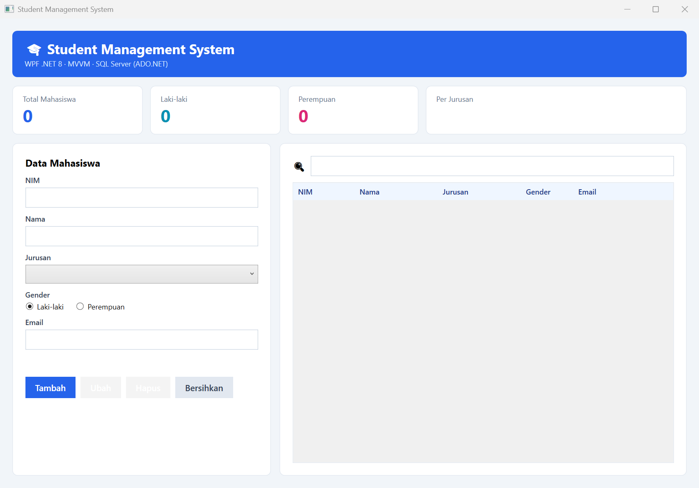
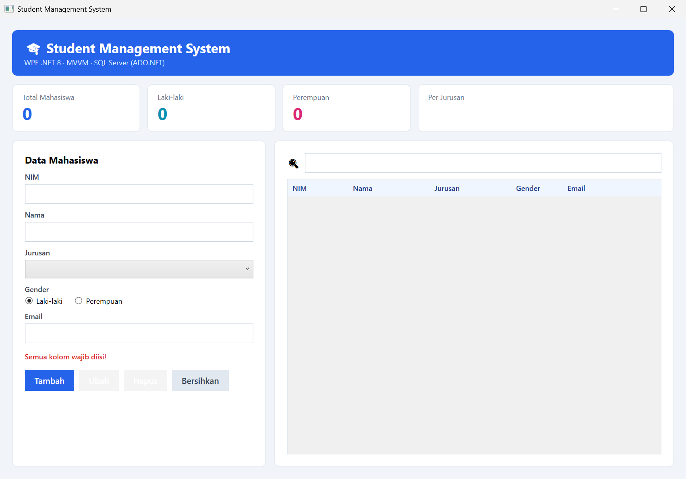
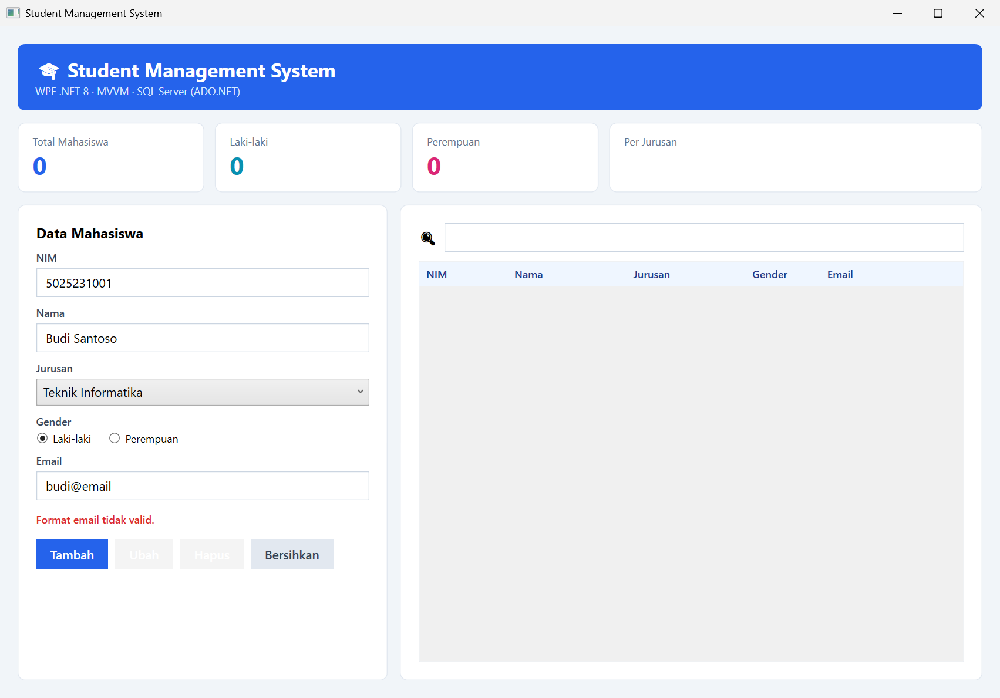
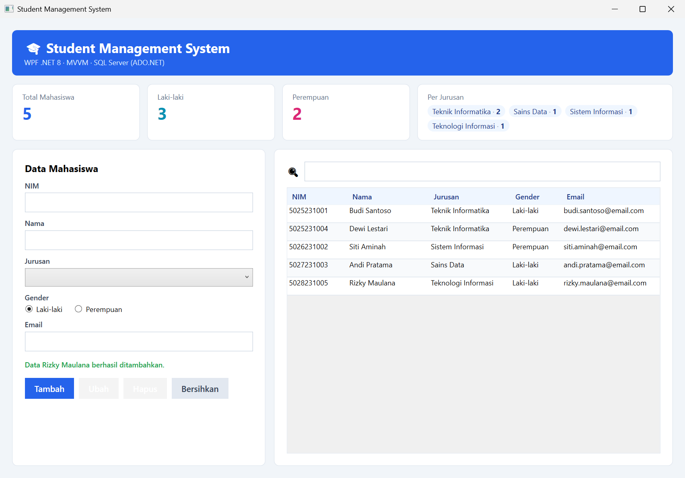
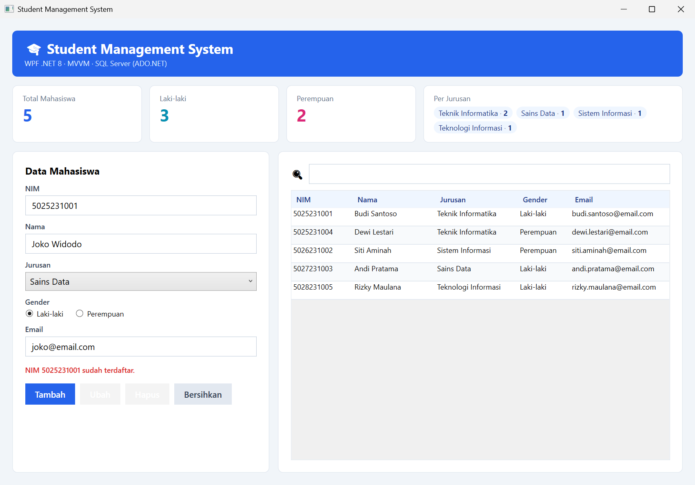
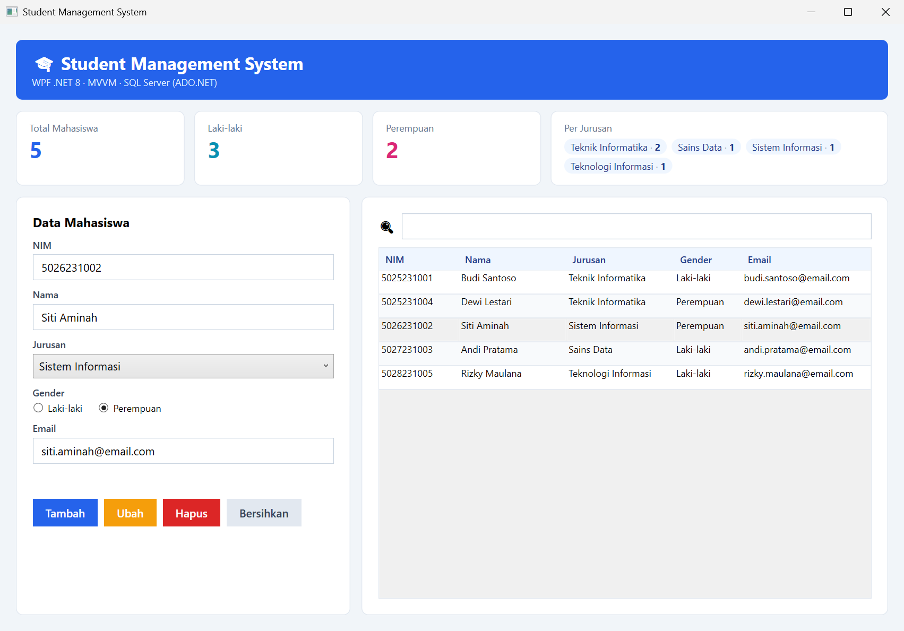
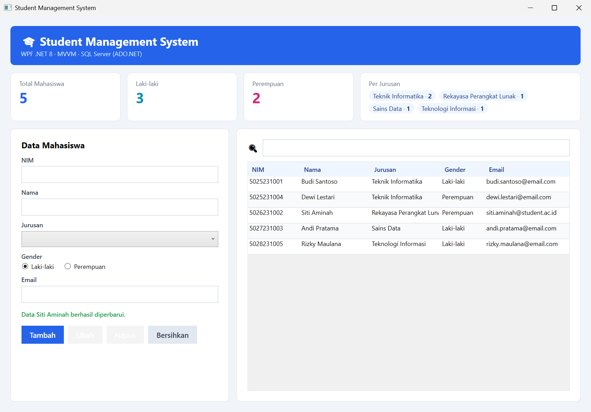
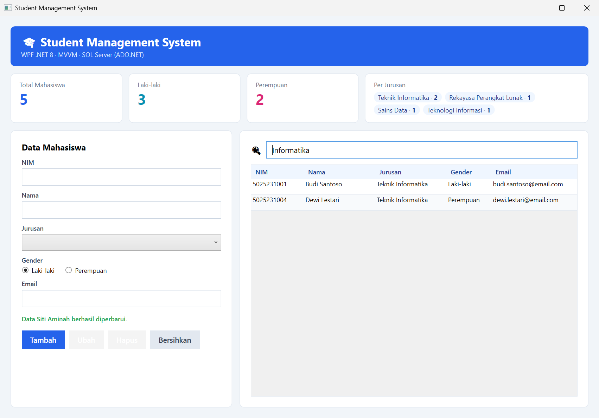
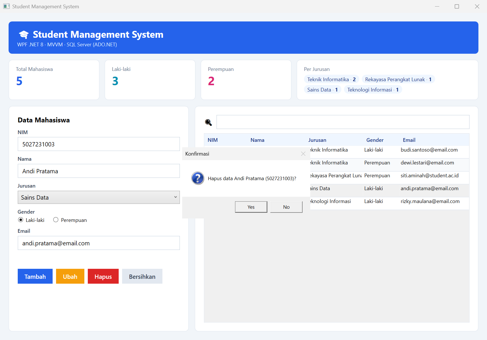
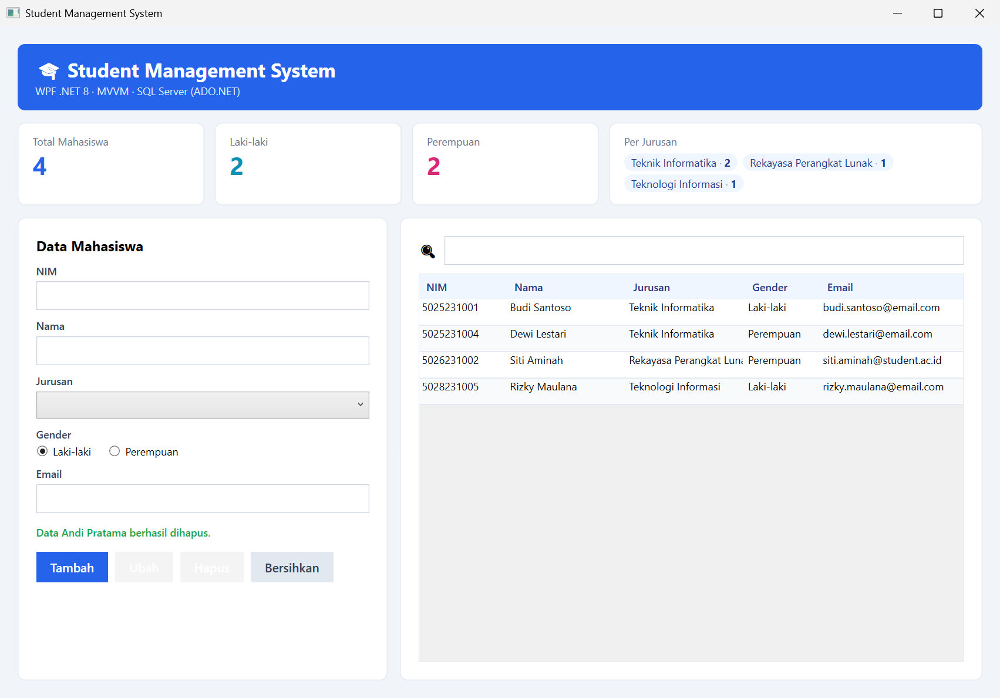

# Tugas 4 PBKK — Student Management System (WPF .NET 8 + MVVM + SQL Server)

Studi kasus aplikasi desktop **Student Management System** berbasis **WPF (.NET 8)** dengan pola arsitektur **MVVM (Model-View-ViewModel)**. Aplikasi mengelola data mahasiswa (NIM, Nama, Jurusan, Gender, Email) dengan fitur **CRUD**, **pencarian**, dan **statistik**, yang seluruhnya terhubung ke **SQL Server** melalui **ADO.NET**.

> Versi siap-tempel untuk Blogspot ada di [`blogspot.html`](blogspot.html) — buka Blogger → New Post → ikon pensil → **HTML view** → paste seluruh isinya.

## Struktur Folder

```
4-Student-Management-MVVM/
├── README.md
├── blogspot.html
├── database.sql                     ← skrip SQL (opsional)
├── screenshots/
└── StudentManagement/
    ├── StudentManagement.csproj
    ├── App.xaml / App.xaml.cs
    ├── Models/
    │   ├── Student.cs               ← MODEL: data mahasiswa
    │   └── Statistik.cs
    ├── Data/
    │   ├── Database.cs              ← connection string + buat DB/tabel otomatis
    │   └── StudentRepository.cs     ← query ADO.NET (CRUD, cari, statistik)
    ├── ViewModels/
    │   ├── BaseViewModel.cs         ← INotifyPropertyChanged
    │   ├── RelayCommand.cs          ← ICommand untuk tombol
    │   └── MainViewModel.cs         ← VIEWMODEL: state + logika layar
    └── Views/
        ├── MainWindow.xaml          ← VIEW: tampilan + binding
        └── MainWindow.xaml.cs
```

## Arsitektur MVVM

```
┌──────────── View ────────────┐   binding    ┌──────── ViewModel ────────┐   panggil   ┌──── Data (ADO.NET) ────┐
│ MainWindow.xaml              │ ───────────► │ MainViewModel             │ ──────────► │ StudentRepository      │
│ TextBox, ComboBox, DataGrid, │ ◄─────────── │ properti + ICommand       │ ◄────────── │ SqlConnection/Command  │
│ Button (Command=...)         │ PropertyChanged                           │   Model     │        │               │
└──────────────────────────────┘              └───────────────────────────┘  (Student)  └────────▼───────────────┘
                                                                                              SQL Server: StudentDB
```

- **Model** (`Student`) — hanya berisi data, tidak tahu UI maupun database.
- **View** (`MainWindow.xaml`) — hanya tampilan. Tidak ada event `Click`; semua terhubung lewat `{Binding}` dan `Command`.
- **ViewModel** (`MainViewModel`) — menyimpan isi form, daftar mahasiswa, statistik, dan logika validasi/CRUD. Tidak menyentuh kontrol UI sama sekali.
- **Repository** (`StudentRepository`) — satu-satunya tempat yang berbicara dengan SQL Server.

## Fitur

| Fitur | Keterangan |
|---|---|
| **Create** | Tombol *Tambah* → `INSERT` |
| **Read** | Tabel otomatis dimuat dari database saat aplikasi dibuka → `SELECT` |
| **Update** | Klik baris → form terisi → ubah → *Ubah* → `UPDATE` |
| **Delete** | Klik baris → *Hapus* → konfirmasi → `DELETE` |
| **Pencarian** | Ketik di kotak 🔍, hasil langsung tersaring (NIM/Nama/Jurusan/Email) → `LIKE` |
| **Statistik** | Total, jumlah laki-laki/perempuan, dan jumlah per jurusan → `COUNT`, `SUM(CASE…)`, `GROUP BY` |
| **Validasi** | Kolom wajib, NIM angka ≥5 digit, format email, NIM tidak boleh ganda |

## Langkah-langkah

> Instalasi .NET SDK, VS Code, dan C# Dev Kit sama seperti Tugas 1. WPF hanya berjalan di Windows.

### 1. Siapkan SQL Server
Instal **SQL Server** (Developer/Express) dan pastikan service-nya berjalan. Jika service mati, buka PowerShell **Run as Administrator**:
```powershell
Start-Service MSSQLSERVER
```
Aplikasi otomatis membuat database `StudentDB` dan tabel `Students` saat pertama dijalankan. Skrip manualnya tersedia di [`database.sql`](database.sql).

> Jika nama server bukan `localhost` (misal `localhost\SQLEXPRESS`), ubah konstanta `Server` di [`Data/Database.cs`](StudentManagement/Data/Database.cs).

### 2. Buat Proyek & Pasang Paket ADO.NET
```bash
dotnet new wpf -n StudentManagement
cd StudentManagement
dotnet add package Microsoft.Data.SqlClient
code .
```

### 3. Isi Kode
Buat folder `Models`, `Data`, `ViewModels`, `Views`, lalu salin file dari folder [`StudentManagement/`](StudentManagement/). Hapus `MainWindow.xaml` bawaan di root (sudah dipindah ke `Views/`) dan pastikan `App.xaml` memakai `StartupUri="Views/MainWindow.xaml"`.

### 4. Jalankan
```bash
dotnet run
```

### 5. Uji
| Uji | Hasil yang diharapkan |
|---|---|
| *Tambah* dengan form kosong | `Semua kolom wajib diisi!` |
| Email `budi@email` | `Format email tidak valid.` |
| Tambah 5 mahasiswa | Tabel & statistik bertambah |
| Tambah dengan NIM yang sudah ada | `NIM ... sudah terdaftar.` |
| Pilih baris → ubah jurusan → *Ubah* | Data & statistik per jurusan berubah |
| Ketik `Informatika` di pencarian | Hanya mahasiswa Teknik Informatika yang tampil |
| Pilih baris → *Hapus* → Yes | Data hilang, total berkurang |

Cek langsung ke database:
```bash
sqlcmd -S localhost -E -C -Q "SELECT * FROM StudentDB.dbo.Students"
```

## Screenshot

| | |
|---|---|
| Tampilan awal (database kosong)<br> | Validasi form kosong<br> |
| Validasi email<br> | Create — 5 data + statistik<br> |
| NIM duplikat ditolak<br> | Pilih baris → form terisi<br> |
| Update berhasil<br> | Pencarian "Informatika"<br> |
| Konfirmasi hapus<br> | Delete berhasil<br> |

## Penjelasan Kode

### Model
- **`Student`** — properti `Id`, `Nim`, `Nama`, `Jurusan`, `Gender`, `Email`, sama persis dengan kolom tabel `Students`.
- **`Statistik`** — wadah hasil hitungan `Total`, `LakiLaki`, `Perempuan`, dan daftar `PerJurusan`.

### Data (ADO.NET)
- **`Database.Inisialisasi()`** — konek ke `master`, jalankan `IF DB_ID('StudentDB') IS NULL CREATE DATABASE`, lalu buat tabel jika belum ada. Jadi aplikasi bisa langsung dipakai tanpa menjalankan skrip SQL manual.
- **Pola ADO.NET** — `SqlConnection` (buka koneksi) → `SqlCommand` (perintah SQL) → `ExecuteReader()` untuk `SELECT`, `ExecuteNonQuery()` untuk `INSERT/UPDATE/DELETE`, `ExecuteScalar()` untuk satu nilai (`COUNT`). Semua dibungkus `using` agar koneksi otomatis ditutup.
- **Parameter `@Nim`, `@Nama`, …** — nilai input tidak pernah digabung langsung ke string SQL, sehingga aman dari **SQL Injection**.
- **`NimSudahAda(nim, abaikanId)`** — `WHERE Nim = @Nim AND Id <> @Id`; saat update, data itu sendiri tidak dianggap duplikat.
- **`GetStatistik()`** — satu query `COUNT(*)` + `SUM(CASE WHEN Gender = ... )` untuk total & gender, dan `GROUP BY Jurusan` untuk per jurusan.

### ViewModel
- **`BaseViewModel`** — implementasi `INotifyPropertyChanged`. Method `Set(ref field, value)` mengubah nilai lalu memberi tahu View agar tampilan ikut berubah.
- **`RelayCommand`** — implementasi `ICommand`. Tombol di XAML memakai `Command="{Binding TambahCommand}"`, bukan event `Click`. Parameter `canExecute` membuat tombol *Ubah*/*Hapus* otomatis nonaktif jika belum ada baris yang dipilih.
- **`MainViewModel`**:
  - Properti form (`Nim`, `Nama`, `Jurusan`, `Email`, `IsLaki`, `IsPerempuan`) terikat *two-way* ke kontrol input.
  - `Students` dan `StatistikJurusan` berupa `ObservableCollection` sehingga DataGrid dan daftar jurusan ter-update otomatis.
  - `SelectedStudent` — saat baris dipilih, setter-nya mengisi form dengan data baris tersebut.
  - `Cari` — setter-nya langsung memanggil `MuatData()`, jadi pencarian berjalan setiap kali mengetik.
  - `Jalankan(aksi, pesan)` — pola umum: jalankan operasi DB → kosongkan form → muat ulang tabel & statistik → tampilkan pesan; error database ditangkap `try/catch` dan ditampilkan, bukan membuat aplikasi crash.
  - `Konfirmasi` — `Func<string, bool>` yang diisi oleh View. ViewModel tidak memanggil `MessageBox` langsung, sehingga tetap bebas dari kode UI.

### View
- `<Window.DataContext><vm:MainViewModel/></Window.DataContext>` — menghubungkan View ke ViewModel.
- `Text="{Binding Nim, UpdateSourceTrigger=PropertyChanged}"` — nilai dikirim ke ViewModel setiap ketikan.
- `DataTrigger` pada pesan — warna merah saat `PesanError = True`, hijau saat sukses.
- `ItemsControl` + `WrapPanel` — menampilkan statistik per jurusan sebagai "chip".
- `MainWindow.xaml.cs` hanya berisi `InitializeComponent()` dan penyedia dialog konfirmasi.

## Ringkasan Perintah
```bash
# (PowerShell Admin, jika SQL Server mati)
Start-Service MSSQLSERVER

dotnet new wpf -n StudentManagement
cd StudentManagement
dotnet add package Microsoft.Data.SqlClient
code .
dotnet run
```
