# Tugas 5 PBKK — Student Registration: Database Relasional & WPF ADO.NET

Laporan ini mendokumentasikan dua praktikum berurutan pada mata kuliah **.NET Programming with C#**:

1. **Praktikum 1** — membangun database relasional **StudentRegistrationDB** pada **SQL Server**.
2. **Praktikum 2** — membuat aplikasi desktop **WPF (C#)** yang membaca data dari database tersebut menggunakan **ADO.NET** dan menampilkannya pada **DataGrid**.

Studi kasus kedua praktikum adalah aplikasi **Student Registration** (pendaftaran mata kuliah mahasiswa).

> Versi siap-tempel untuk Blogspot ada di [`blogspot.html`](blogspot.html) — buka Blogger → New Post → ikon pensil → **HTML view** → paste seluruh isinya.

## Struktur Folder

```
5-Student-Registration-DB/
├── README.md
├── blogspot.html
├── screenshots/
├── database/
│   ├── 01_create_database.sql   ← membuat database, 4 tabel, constraint, view
│   ├── 02_seed_data.sql         ← data contoh
│   └── 03_queries.sql           ← query uji (JOIN, GROUP BY, LEFT JOIN, uji constraint)
└── StudentRegistrationApp/
    ├── StudentRegistrationApp.csproj
    ├── App.xaml / App.xaml.cs
    ├── DataAccess.cs            ← semua kode ADO.NET
    ├── MainWindow.xaml          ← tampilan (filter + DataGrid)
    └── MainWindow.xaml.cs
```

---

## Praktikum 1 — Database StudentRegistrationDB

### Rancangan Tabel

| Tabel | Isi | Primary Key | Foreign Key |
|---|---|---|---|
| `Programs` | Program studi | `ProgramId` | — |
| `Students` | Data mahasiswa | `StudentId` | `ProgramId` → `Programs` |
| `Courses` | Mata kuliah | `CourseId` | `ProgramId` → `Programs` |
| `Registrations` | Pendaftaran mahasiswa ke mata kuliah | `RegistrationId` | `StudentId` → `Students`, `CourseId` → `Courses` |

**Relasi:**
- `Programs` 1 — N `Students` (satu prodi punya banyak mahasiswa)
- `Programs` 1 — N `Courses` (satu prodi punya banyak mata kuliah)
- `Students` N — N `Courses` melalui tabel penghubung `Registrations`

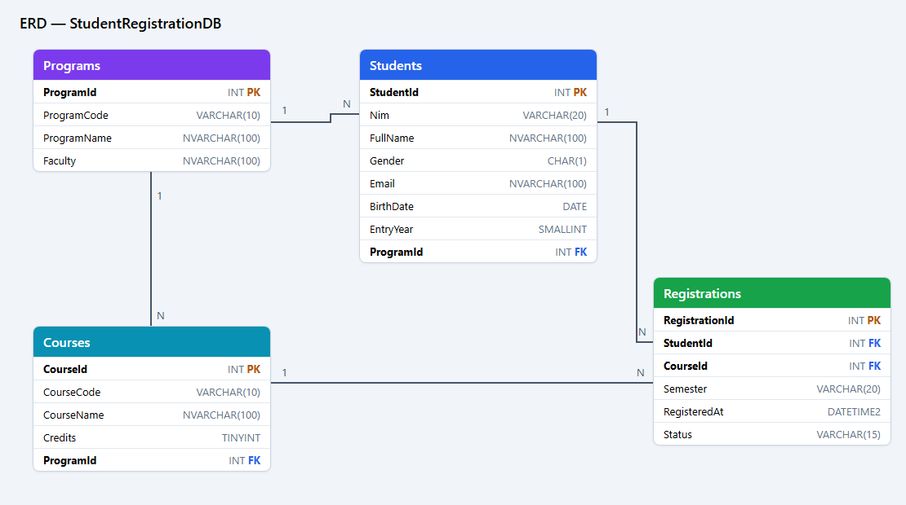

### Constraint yang Dipakai

| Constraint | Contoh | Tujuan |
|---|---|---|
| `PRIMARY KEY` + `IDENTITY` | `StudentId INT IDENTITY(1,1) PRIMARY KEY` | ID unik yang bertambah otomatis |
| `FOREIGN KEY` | `FK_Students_Programs` | Mahasiswa hanya bisa memakai prodi yang ada |
| `UNIQUE` | `Nim`, `Email`, `(StudentId, CourseId, Semester)` | Tidak ada NIM/email ganda; tidak bisa daftar MK yang sama 2× di semester yang sama |
| `CHECK` | `Gender IN ('L','P')`, `Credits BETWEEN 1 AND 6` | Menolak nilai yang tidak masuk akal |
| `DEFAULT` | `RegisteredAt DEFAULT SYSDATETIME()`, `Status DEFAULT 'Aktif'` | Nilai otomatis jika tidak diisi |
| `ON DELETE CASCADE` | `FK_Registrations_Students` | Jika mahasiswa dihapus, pendaftarannya ikut terhapus |

Selain tabel, dibuat juga **view** `vw_RegistrationDetails` yang menggabungkan 4 tabel sekaligus agar mudah dibaca aplikasi.

### Langkah

1. Pastikan SQL Server berjalan (PowerShell **Run as Administrator**: `Start-Service MSSQLSERVER`).
2. Jalankan skrip secara berurutan:
   ```bash
   cd database
   sqlcmd -S localhost -E -C -i 01_create_database.sql
   sqlcmd -S localhost -E -C -i 02_seed_data.sql
   sqlcmd -S localhost -E -C -i 03_queries.sql
   ```
   Skrip juga bisa dibuka dan dijalankan di **SSMS** atau **Azure Data Studio**.

### Hasil

| | |
|---|---|
| Pembuatan database & data contoh<br>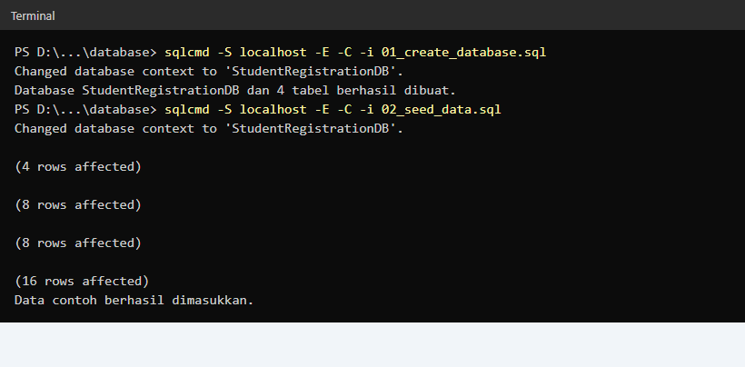 | Daftar tabel & constraint<br>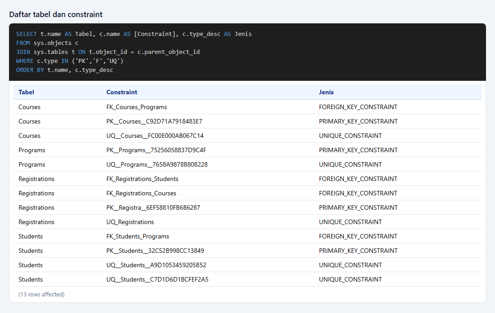 |
| JOIN Mahasiswa + Prodi<br>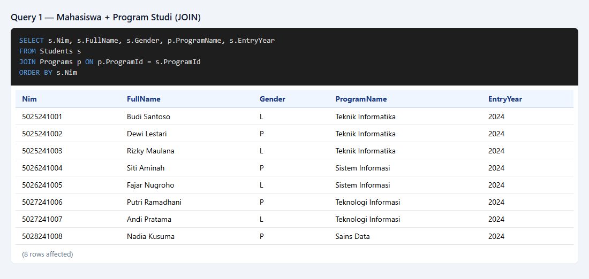 | Total SKS per mahasiswa (GROUP BY)<br>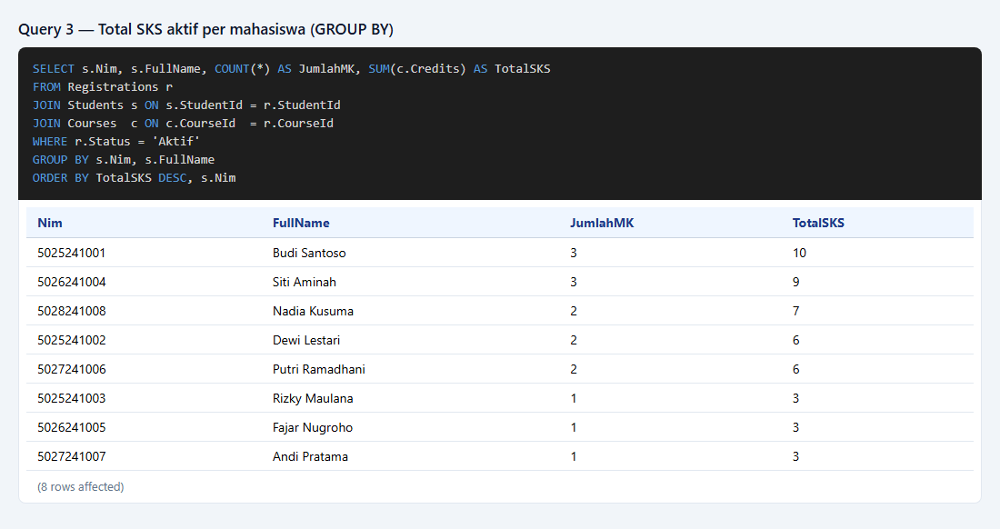 |
| Peserta per mata kuliah (LEFT JOIN)<br>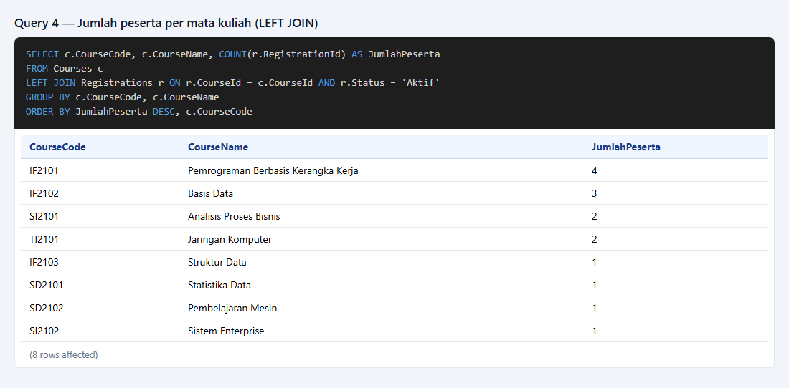 | Uji constraint UNIQUE & FOREIGN KEY<br>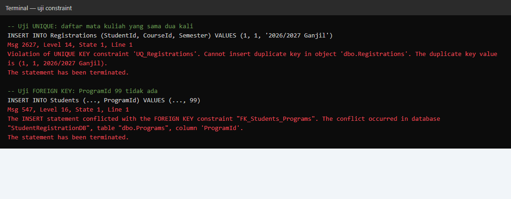 |

---

## Praktikum 2 — Aplikasi WPF + ADO.NET

### Fitur
- **4 tampilan data** dipilih lewat ComboBox: *Mahasiswa*, *Registrasi Mata Kuliah*, *Total SKS per Mahasiswa*, *Mata Kuliah*. Semuanya hasil query `JOIN` dari beberapa tabel.
- **Filter program studi** (isinya dibaca dari tabel `Programs`).
- **Pencarian** NIM / nama / mata kuliah, langsung tersaring saat mengetik.
- **Kartu ringkasan**: jumlah mahasiswa, prodi, mata kuliah, dan registrasi aktif.
- Tombol **Muat Ulang** dan status bar jumlah baris.

### Langkah
```bash
dotnet new wpf -n StudentRegistrationApp
cd StudentRegistrationApp
dotnet add package Microsoft.Data.SqlClient
code .
```
Tambahkan `DataAccess.cs`, lalu ganti isi `App.xaml`, `MainWindow.xaml`, dan `MainWindow.xaml.cs` dengan kode dari folder [`StudentRegistrationApp/`](StudentRegistrationApp/). Jalankan:
```bash
dotnet run
```

> Jika nama server bukan `localhost` (misal `localhost\SQLEXPRESS`), ubah `ConnectionString` di [`DataAccess.cs`](StudentRegistrationApp/DataAccess.cs).

### Hasil

| | |
|---|---|
| Mahasiswa<br>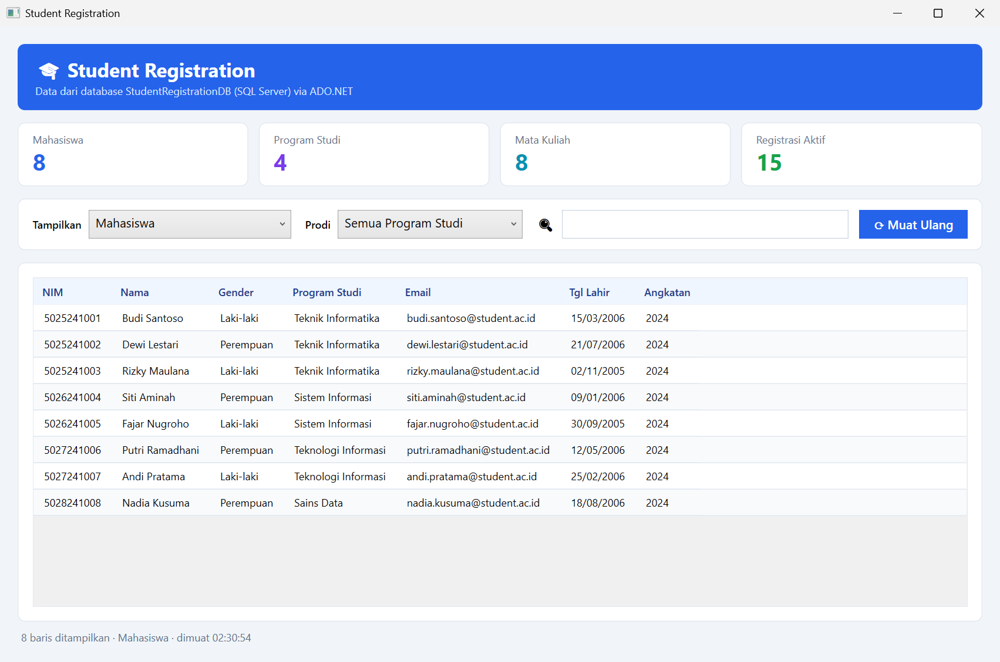 | Registrasi Mata Kuliah<br>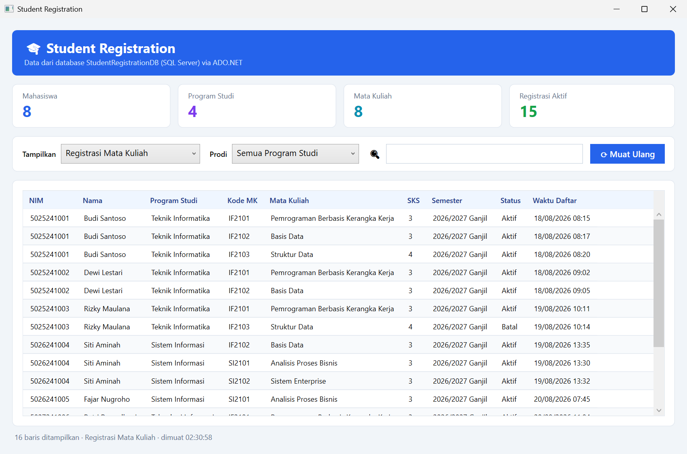 |
| Total SKS per Mahasiswa<br>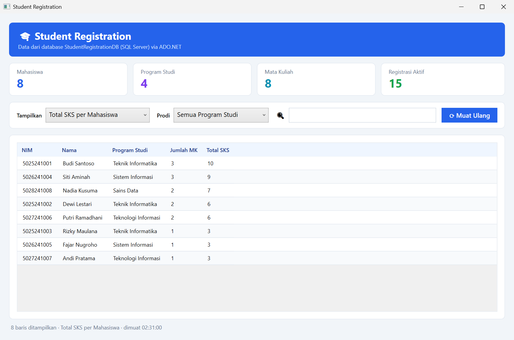 | Mata Kuliah<br>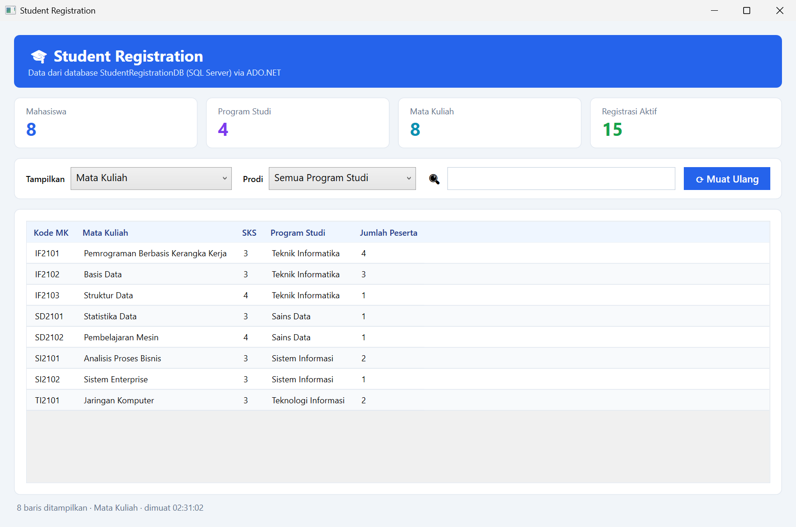 |
| Filter prodi Teknik Informatika<br>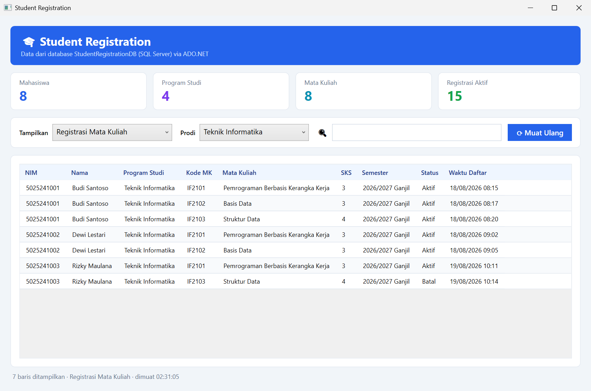 | Pencarian "Basis Data"<br>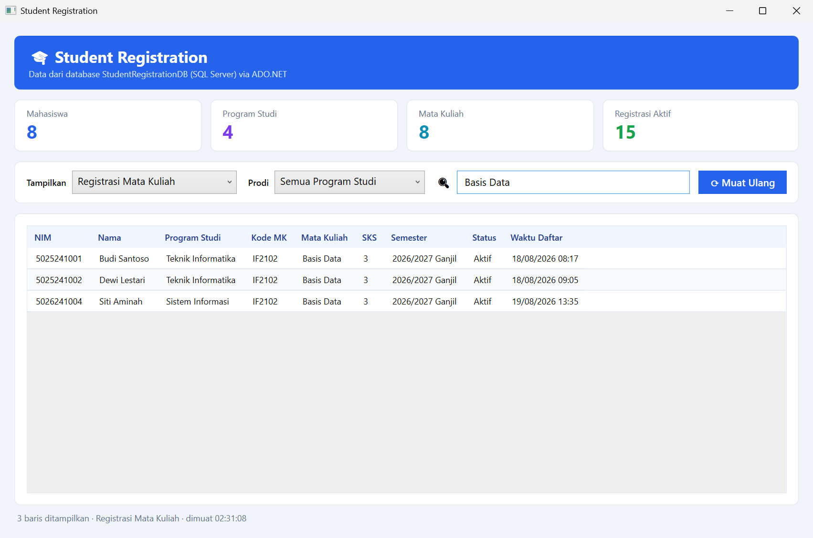 |

### Penjelasan Kode

**`DataAccess.cs` — tiga cara membaca data dengan ADO.NET**

| Cara | Dipakai untuk | Kenapa |
|---|---|---|
| `SqlDataAdapter.Fill(DataTable)` | Isi DataGrid | `DataTable` bisa langsung jadi `ItemsSource` DataGrid lewat `.DefaultView`, dan kolomnya otomatis dibuat dari hasil query |
| `SqlDataReader` | ComboBox program studi | Membaca baris satu per satu (maju saja), ringan untuk data kecil yang diubah ke objek sendiri |
| `ExecuteScalar()` | Kartu ringkasan | Hanya butuh satu angka (`COUNT(*)`) |

- **Connection string** `Server=localhost;Database=StudentRegistrationDB;Trusted_Connection=True;TrustServerCertificate=True;` — login memakai akun Windows (tanpa password).
- **Query dalam `Dictionary`** — nama tampilan (`"Mahasiswa"`, dll.) dipetakan ke query SQL-nya. ComboBox cukup diisi `Queries.Keys`; menambah tampilan baru cukup menambah satu entri.
- **Alias kolom** `AS [Program Studi]` — karena `AutoGenerateColumns="True"`, nama alias langsung menjadi judul kolom DataGrid.
- **Parameter `@ProgramId` dan `@Cari`** — filter dikirim sebagai parameter, bukan digabung ke string SQL, sehingga aman dari SQL Injection. `@ProgramId = 0` berarti "semua prodi".
- **`using`** — koneksi selalu ditutup walaupun terjadi error.

**`MainWindow.xaml.cs`**
- `Window_Loaded` mengisi kedua ComboBox lalu memuat data pertama kali.
- `Filter_Changed` dipasang ke ComboBox dan TextBox, jadi setiap perubahan filter langsung menjalankan query ulang. Flag `siap` mencegah query berjalan saat ComboBox masih diisi.
- Semua pembacaan dibungkus `try/catch`; jika database tidak bisa dihubungi, pesan merah muncul di status bar dan aplikasi tidak crash.

**`MainWindow.xaml`**
- `UniformGrid Columns="4"` untuk kartu ringkasan dengan lebar sama.
- `DataGrid` dengan `AutoGenerateColumns="True"` dan `IsReadOnly="True"` karena praktikum ini hanya membaca data.
- `ColumnHeaderStyle` dan `CellStyle` untuk tampilan tabel yang rapi.

## Ringkasan Perintah
```bash
# Praktikum 1
cd database
sqlcmd -S localhost -E -C -i 01_create_database.sql
sqlcmd -S localhost -E -C -i 02_seed_data.sql
sqlcmd -S localhost -E -C -i 03_queries.sql

# Praktikum 2
dotnet new wpf -n StudentRegistrationApp
cd StudentRegistrationApp
dotnet add package Microsoft.Data.SqlClient
dotnet run
```
